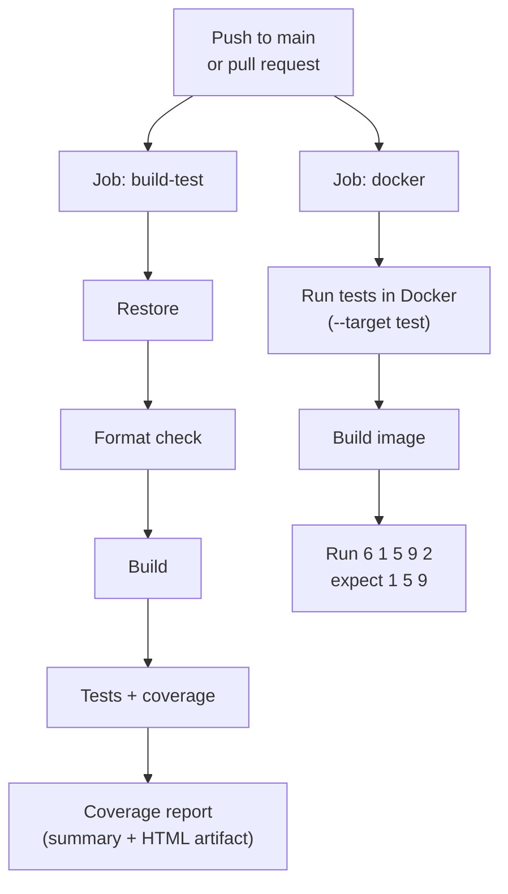

# Longest Increasing Subsequence

A C# / .NET 10 console app. It takes a string of whitespace-separated integers and outputs the longest run of values that keep going up. If several runs are equally long, the earliest one wins.

```text
$ dotnet run --project src/LongestIncreasingSubsequence -- "6 1 5 9 2"
1 5 9
```

## Setup

1. **Install the .NET 10 SDK.**
   - Windows: `winget install Microsoft.DotNet.SDK.10`
   - Mac or Linux: download it from [dotnet.microsoft.com](https://dotnet.microsoft.com/download/dotnet/10.0)
2. **Check it worked.** Open a new terminal and run `dotnet --version`. You should see `10.0.x`.
3. **Get the code.**

   ```bash
   git clone https://github.com/dxv22/5e8f6ec7-20c5-4e53-aa97-d233b4efb321.git
   cd 5e8f6ec7-20c5-4e53-aa97-d233b4efb321
   ```

4. **Run the tests.** If they all pass, you're set up.

   ```bash
   dotnet test
   ```

Docker is optional. Install [Docker Desktop](https://www.docker.com/products/docker-desktop/) only if you want to run the container steps below.

## Rules

The provided test cases only match a **contiguous** run. For example, `6 2 4 3 1 5 9` expects `1 5 9`, where a classic non-contiguous subsequence would give `2 4 5 9`.

- Each number must be bigger than the one before it. `1 2 2 3` gives `1 2`.
- Numbers must sit next to each other. `6 2 4 3 1 5 9` gives `1 5 9`.
- If two runs are equally long, the first one wins. `1 3 2 4` gives `1 3`.
- A single number is a run of length one. `9 7 5 3 1` gives `9`.
- Negative numbers are supported. `-5 -2 -10 -1` gives `-5 -2`.
- Empty or whitespace-only input gives an empty answer. Extra whitespace is ignored.
- A token that is not a valid 32-bit integer (including values that overflow `int`) throws an `ArgumentException`.

## Run

```bash
dotnet run --project src/LongestIncreasingSubsequence -- "6 1 5 9 2"
```

| Input | Result |
|---|---|
| A list of numbers in quotes | Prints the answer, exit 0 |
| Nothing, or `""` | Prints a blank line, exit 0 |
| A value that isn't a whole number | Error on stderr, exit 1 |
| More than one argument | Usage on stderr, exit 2 |

## Test

```bash
dotnet test
```

This runs all 11 provided cases, plus edge cases, tie-breaking, invalid input, a large input, and 1,000 seeded random inputs checked against a brute-force version. The provided cases are read from `tests/LongestIncreasingSubsequence.Tests/TestData/` (`caseNN.input.txt` and `caseNN.expected.txt`), because several inputs are thousands of numbers on one line.

To check formatting and generate a coverage report:

```bash
dotnet format --verify-no-changes
dotnet test --collect:"XPlat Code Coverage" --results-directory ./coverage
dotnet tool install --global dotnet-reportgenerator-globaltool
reportgenerator -reports:"coverage/**/coverage.cobertura.xml" -targetdir:coverage-report -reporttypes:Html
```

Then open `coverage-report/index.html`. Code style rules also run during the build, and warnings fail it.

## Approach

A single pass tracks the start of the current increasing run. When a value is not greater than its predecessor, a new run starts. The best run is replaced only when a run is strictly longer, which keeps the earliest of equally long runs. This takes O(n) time.

For `6 1 5 9 2`, the runs are `6`, `1 5 9` and `2`. `1 5 9` is the longest, so it is the answer.

The public API is one method, `LongestIncreasingSubsequenceFinder.FindLongestIncreasingSubsequence(string)`. `Program.cs` is a thin wrapper around it.

## Docker

```bash
docker build --target test .               # run the tests in a container
docker build -t lis-app .                  # build the image
docker run --rm lis-app "6 1 5 9 2"        # prints 1 5 9
```

The image uses a multi-stage build and runs as a non-root user.

## CI

`.github/workflows/ci.yml` runs on pushes to `main` and on pull requests.



| Job | What it does |
|---|---|
| `build-test` | Restore, formatting check, Release build, tests with coverage. Publishes a coverage summary on the run page and uploads the HTML report as the `coverage-report` artifact |
| `docker` | Runs the tests in Docker, builds the image, runs it with `"6 1 5 9 2"` and asserts the output is `1 5 9` |
